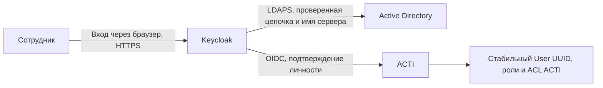

# Task 011 — приёмка идентификации AD/OIDC

Дата: 16.10.2026. Текущий кандидат: `23dc451a63e8018809a5d2c0c6224ff1f7899aab`.
Браузерная приёмка идентификации выполнена на `51d06384bc9b1a0e8f652fce637f03cdcf9c3924`;
новый кандидат содержит исправления проверки восстановления и принят
дополнительными 120 целевыми тестами и Ruff. **Реальный внешний backup/restore
этого кандидата с действующим IdP — PASS.**

## Что настроено и зачем

Identity Provider (IdP) — служба единого входа. Сотрудник подтверждает в ней свою
личность, а ACTI получает проверенное подтверждение по протоколу OpenID Connect
(OIDC). Пароль доменного пользователя ACTI не получает.
Сейчас к IdP подключена ACTI; другие веб-системы подключаются к нему отдельно.

Active Directory (AD) хранит доменные учётные записи. Keycloak связывает этот
каталог с веб-входом: проверяет доменную личность через защищённое LDAP-соединение
и выдаёт подтверждение OIDC. ACTI сопоставляет его с заранее назначенным
пользователем и проверяет собственные роли и права при каждом запросе.

Таким образом, доменная учётная запись сама по себе не открывает документы.
Администратор ACTI явно назначает соответствие личности и существующего User UUID.
Аварийный локальный вход администратора остаётся доступным.

## Обследование и выбранный вариант

Проверены известные узлы, настройки и доступные службы. DNS/SRV содержал три
записи контроллеров; сопоставление реальных машин подтвердило два различных
контроллера домена. Готовый совместимый IdP в этом ограниченном охвате не найден.

Выбран Keycloak **26.8.1** с образом, закреплённым по digest. Он работает на
существующей ACTI VM в production-режиме `start --optimized`, через существующий
HTTPS reverse proxy под `/idp/`. Порт Keycloak на хост не публикуется.
Контейнер ограничен 1536 МиБ памяти, 1,5 CPU и восемью соединениями с PostgreSQL;
файловая система контейнера read-only, временные каталоги эфемерны.

В существующей PostgreSQL создана отдельная схема `keycloak` и отдельная
непривилегированная роль провайдера. Права разделены со схемой `public` ACTI.
OIDC-секреты передаются только API; worker и процесс миграций их не получают.
Настройки, пароли и ключи хранятся вне Git в защищённых конфигурациях.

IdP и ACTI сейчас имеют общую VM и PostgreSQL. Это единый домен отказа;
отказоустойчивый кластер IdP в текущую приёмку не входит.

## Подключение AD

На одном выбранном контроллере подготовлен новый серверный сертификат LDAPS
с проверяемой цепочкой, DNS SAN и server-auth EKU. Приватный ключ leaf находится
в защищённом машинном хранилище контроллера и не экспортируется. Публичный
сертификат выделенного CA добавлен в доверие этой связи; приватный ключ CA
остаётся в защищённом локальном каталоге оператора. Контроллер не перезагружался.

Keycloak использует LDAP federation в режиме `READ_ONLY`, проверяет CA и имя
сервера; отключены регистрация пользователей в AD, смена их паролей, referrals
и широкая плановая синхронизация. Стабильный LDAP-идентификатор — `objectGUID`.
Для bind создана отдельная обычная доменная техническая учётная запись без
административных привилегий. Существующие пользователи AD, их членство,
права и доменные политики не изменялись.

Режим `READ_ONLY` ограничивает операции Keycloak. Стандартные права обычной
доменной учётной записи отдельно учитываются при эксплуатации; абсолютный
серверный запрет любых записей от её имени этой проверкой не доказан.
Профиль чтения исходных SQL Server является отдельным условием Task 011.

Сроки требуют сопровождения:

| Объект | Срок | Действие |
| --- | --- | --- |
| Пароль LDAP reader | Ручная ротация не позднее 14.01.2027 | Согласованно обновить AD и bind secret Keycloak, повторить strict-TLS bind и доменный вход |
| Сертификат LDAPS | Истекает 16.10.2027 | Выпустить и проверить замену заранее |
| Выделенный CA LDAPS | Истекает 15.10.2028 | Сменить с периодом перекрытия доверия |

Автоматическое продление сертификатов и независимое offline escrow приватного
ключа CA требуют отдельного эксплуатационного процесса.

## Политика личности и доступа

- Ключ внешней личности — точная пара `(issuer, subject)`, связанная с существующим
  User UUID ACTI. Логин, SID, ФИО и email не заменяют UUID.
- Автоматическое создание пользователей и связывание по ФИО/email отключены.
  Доменная личность без явной связи получает отказ.
- Роли, ACL реестров и документов, номера и история остаются в ACTI. Группы или
  роли из IdP не назначают права ACTI автоматически.
- Сервисные, неактивные пользователи и пользователи без допустимых ролей не
  допускаются к интерактивной привязке.
- Отвязка личности немедленно отзывает её OIDC-сессии; локальные credentials
  и локальные сессии пользователя сохраняются. Существующий аварийный локальный
  администратор проверен отдельно.
- Массовое сопоставление сотрудников и назначение им рабочих прав не выполнялось.
  Для каждого сотрудника требуется явное назначение соответствующего User UUID.

По отдельному явному поручению пользователя связана его личная доменная
учётная запись с прежним административным User UUID ACTI. Перед связыванием
проверены точные `objectGUID` и SID доменной личности, включая совпадение SID
с текущей Windows-личностью. Соответствие в IdP проверено по LDAP-идентификатору;
ФИО и email не участвовали в сопоставлении. Прежний User UUID и административная
роль сохранены, локальный резервный вход после связывания — **PASS**.
Проверка этой личной связи не включала ввод или проверку личного пароля
пользователя в браузере; такой парольный вход не заявляется как выполненный.

OIDC использует Authorization Code, PKCE S256, одноразовый state с TTL 300 секунд,
nonce и привязку к браузеру через Secure/HttpOnly/SameSite=Lax cookie. Callback
обменивает code на сервере и проверяет RS256, issuer, audience, azp и сроки токена.
Разрешён точный HTTPS callback без wildcard. Проверка TLS обязательна,
ответы провайдера ограничены по объёму и времени; серверный HTTP-клиент не
переходит по перенаправлениям провайдера. ACTI не сохраняет access/refresh tokens
и не выдаёт их браузеру как собственные credentials.

После входа действует собственная сессия ACTI на **12 часов**. Локальная блокировка
пользователя ACTI или отвязка личности прекращают её доступ сразу. Блокировка
только в AD/IdP запрещает следующий доменный вход; существующая сессия ACTI может
действовать до истечения срока. Прежний `must_change_password` сохранён.
Кнопка выхода завершает сессию ACTI; SSO-сессия IdP сохраняется, поэтому следующий
корпоративный вход может пройти без повторного ввода пароля. Глобальный и
back-channel logout не реализованы.

## Проверки

Проверки выполнены на настоящих HTTPS, Backend API и PostgreSQL, с браузерным
переходом в действующий IdP. Ответы входа не подменялись.
Первичный role/domain прогон завершил семь сценариев с результатом **PASS**.

| Проверка | Результат |
| --- | --- |
| Полный Backend, Python 3.12 и изолированная PostgreSQL | **487 PASS**, 9 Windows-specific SKIP; одно предупреждение существующей совместимости Starlette/httpx |
| Ruff затронутых Backend/deploy файлов | **PASS** |
| Frontend: тесты, typecheck, production build | **112 PASS**, typecheck/build **PASS** |
| OIDC admin/editor/viewer, сохранение UUID и ролей, серверные запреты | **PASS**, реальные браузерные сценарии |
| Настоящий AD login технической тестовой личности без связи | **PASS**, вход в ACTI запрещён |
| Временная явная связь доменной личности с viewer UUID | **PASS**, допустимый вход и запрет привилегированной операции **403** |
| Отвязка доменной личности | **PASS**, её сессия получает **401**, локальный резервный admin — **200** |
| Остановка только IdP | **PASS**, корпоративный старт **503**, локальный admin продолжает входить; logout даёт **401** |
| Штатное восстановление стека после остановки IdP | **PASS** |
| Повторный полный role/domain browser smoke после восстановления | **PASS**, повторно пройдены все семь сценариев |
| Личная доменная связь по явному поручению пользователя | **PASS**, сверены GUID/SID, сохранены прежние User UUID и роль, проверен локальный резервный вход; личный парольный вход не проверялся |
| Проверка восстановления на текущем кандидате | **120 целевых PASS**, включая восемь новых регрессий на реальной PostgreSQL; Ruff **PASS** |
| Внешний backup и изолированный restore с действующим IdP | **PASS**, внешний шифрованный snapshot и заново скачанные данные; совпали 155 таблиц, одна последовательность и 111 оригиналов |

Секреты, внутренние адреса, имена учётных записей и машинные идентификаторы
в опубликованные доказательства не включены. Закрытые квитанции и инструкция
оператора сохранены отдельно от репозитория.

## Восстановление и общий статус

Схемы `public` и `keycloak` находятся в одной базе и попадают в один атомарный
PostgreSQL dump существующего шифрованного внешнего backup. Восстановитель
расширен: manifest и fingerprint проверяют данные, последовательности и DDL
обеих схем. Проверка на реальной тестовой PostgreSQL обнаруживает изменения
содержимого и структуры схемы IdP, включая сложные quoted identifiers.
Для схемы `keycloak` сравнивается порядок видимых столбцов: физические пропуски
`attnum`, остающиеся после удаления столбцов, не меняют семантический fingerprint.
Имена, типы, ограничения и фактический видимый порядок остаются значимыми.
Прежний fingerprint схемы `public` сохранён без изменения; совместимость
проверена целевыми регрессиями.
Секреты провайдера и его ключи подписи входят в чувствительные данные backup.

На кандидате `23dc451a63e8018809a5d2c0c6224ff1f7899aab` создан настоящий
шифрованный snapshot на FILESERVER, выполнен `restic check --read-data`.
Данные заново скачаны, расшифрованы и проверены; изолированная копия использовала
именно этот внешний dump и набор оригиналов. Совпали fingerprint схемы и данных
обеих схем: **155 таблиц (54 `public` + 101 `keycloak`), одна последовательность,
111 оригинальных файлов / 3 342 817 байт**.

Скопированные сессии отозваны только в клоне. Действующая cookie основной ACTI
получила **401 в клоне и 200 на основной системе**. Настоящий HTTPS-браузер
подтвердил свежий вход, две сохранённые контрольные точки Task 009 с историей
и скачивание оригинала с совпадающим SHA-256. Неожиданных бизнес-записей — **0**.
Клон, скачанная cleartext-копия и туннель очищены; собственная сессия на основной
системе завершена штатным logout с последующим **401**.

Это восстановление из внешнего хранилища в изолированной среде на действующей
ACTI VM. Восстановление на новом физическом сервере и bare-metal DR в проверку
не входили.

Текущий документ фиксирует приёмку идентификации. Общий Task 011 и разрешение
Task 012 определяются единым планом с учётом приёмки источников, эксплуатации
и прочих оставшихся условий. Приёмка источников и эксплуатации ещё блокирует
завершение Task 011; Task 012 остаётся **NO-GO**. Миграция исходных данных
не запускалась; SQL Server и
`legacy/v2/` сохраняются без изменений.

Технический порядок настройки: [deploy/KEYCLOAK.md](../../deploy/KEYCLOAK.md).
Единый план: [ACTI_V3_MASTER_TASKS_003_012.md](ACTI_V3_MASTER_TASKS_003_012.md).

## Дополнение 16.10.2026 — бизнес-права после OIDC-входа

На действующем приложении `572a15ea7e6c657d8d999ae3cceae63aad4d9e99`
выполнен отдельный сквозной прогон через настоящий HTTPS, Keycloak OIDC,
Backend API, PostgreSQL и worker, без подмены ответов. Ревизия приложения
проверена до и после прогона. Проверка завершена в 11:51 UTC: **6 сценариев PASS**.

1. Новая явно связанная тестовая личность после OIDC-входа сохраняет точный
   ACTI User UUID и локальную роль читателя.
2. Опубликованная форма, присвоенный номер и доступные поля читаются; закрытые
   поле и файл скрыты, отдельный закрытый документ возвращает **404**.
3. Обычный интерфейс поиска отправляет настоящий запрос и показывает одну
   разрешённую карточку; поиск закрытого реквизита даёт ноль результатов.
4. Поиск по метаданным и индексированному содержимому не раскрывает закрытые
   поле/файл. До проверки запретов редактор успешно нашёл те же контрольные
   значения: нулевой результат читателя не объясняется отсутствием индекса.
5. Присвоенная запись книги номеров, опубликованная версия процесса, экземпляр
   и история читаются; резервирование номера, изменение и выполнение действия
   процесса читателем возвращают **403**.
6. Штатный logout отзывает сессию; последующий запрос возвращает **401**.

Для этого прогона создана отдельная **локальная личность Keycloak** в действующем
провайдере. Новый парольный вход в AD не выполнялся. Его доказательство остаётся
в ранее принятом доменном прогоне на `51d06384bc9b1a0e8f652fce637f03cdcf9c3924`;
между этой ревизией и текущей проверены неизменность `backend/app/identity`
и границ `auth.py`, `oidc.py`, `dependencies.py`. Новая проверка дополняет прежние
доменные и трёхролевые сценарии бизнес-поведением; не заменяет их новым AD PASS.
AD и настройки федерации в этом прогоне не менялись.

Использованы новые изолированные синтетические реестры, карточки, оригиналы,
серии и процессы. Первый прогон остановился на ошибке проверочного сценария:
создание связи ожидало HTTP 201 вместо предусмотренного API HTTP 200. Его
очистка прошла; после исправления ожидания новый прогон полностью прошёл.
В обоих случаях новые учётные записи ACTI и провайдера отключены, связи личности
удалены, права реестров и серий отозваны. Неизменяемые синтетические записи двух
изолированных пространств остаются доступны только администраторам; удаление
аудита и бизнес-истории не выполнялось. Прежние пользователи, личности провайдера
и реестры сверены с исходным состоянием и сохранены.

Закрытые квитанции, результаты API и снимок настоящей карточки сохранены вне Git.
Изменений кода, deployment, SQL Server и исходных файлов, перезапуска VM или
миграции в этой проверке не было. Общий Task 011 остаётся **BLOCKED**: отложены
strict SQL TLS и проверка reboot с независимым console/recovery. Task 012 —
**NO-GO**.
